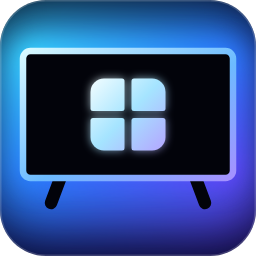
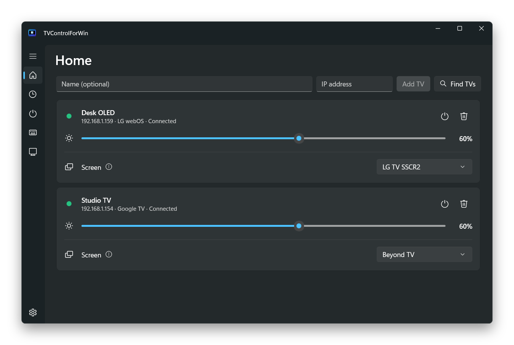
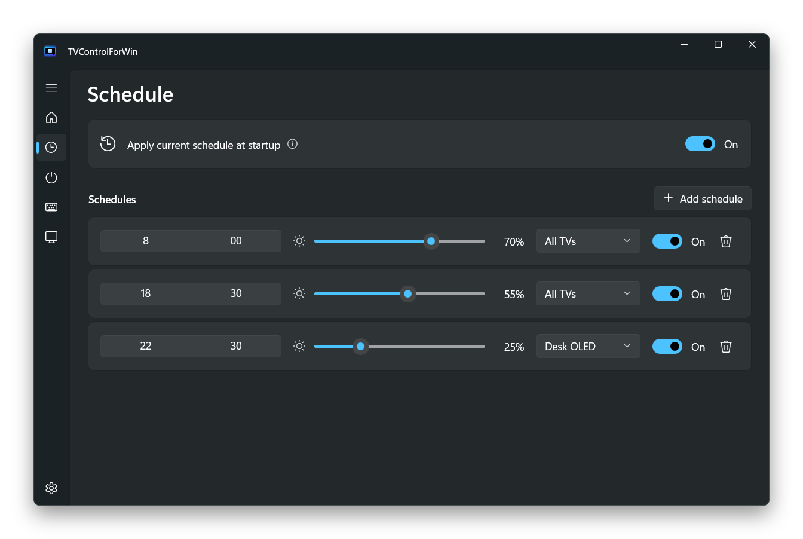
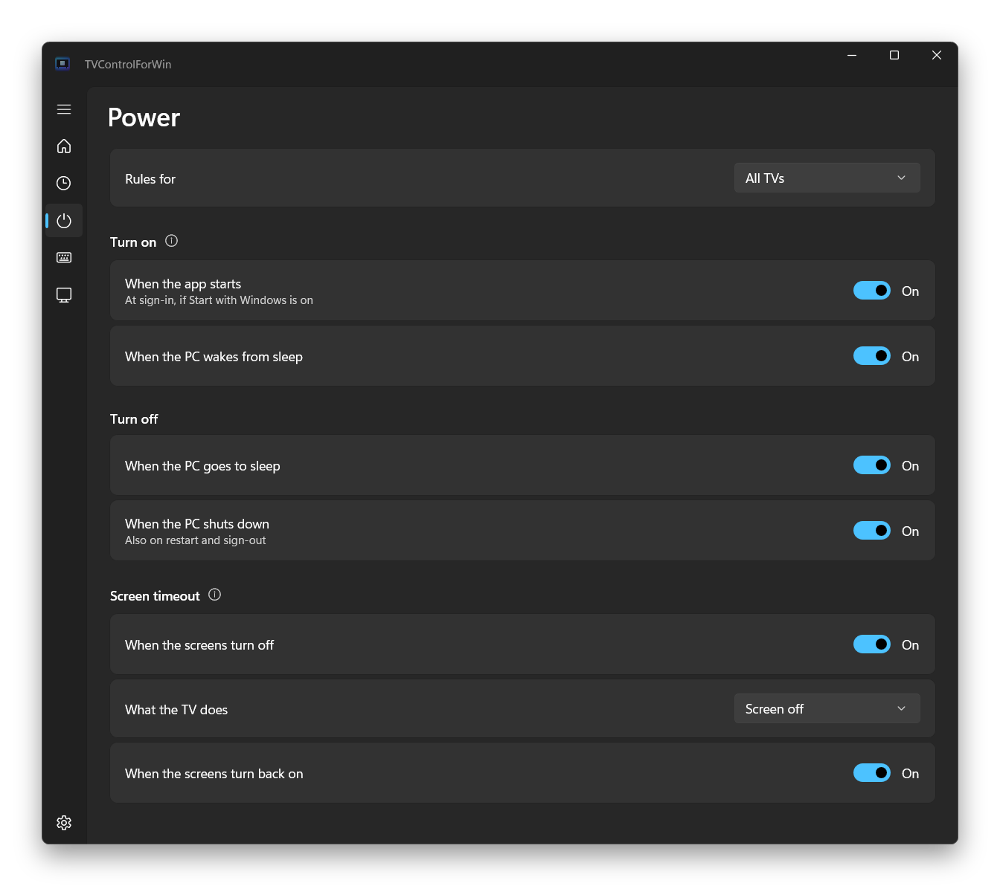
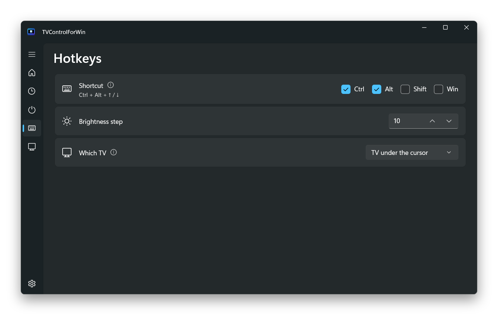
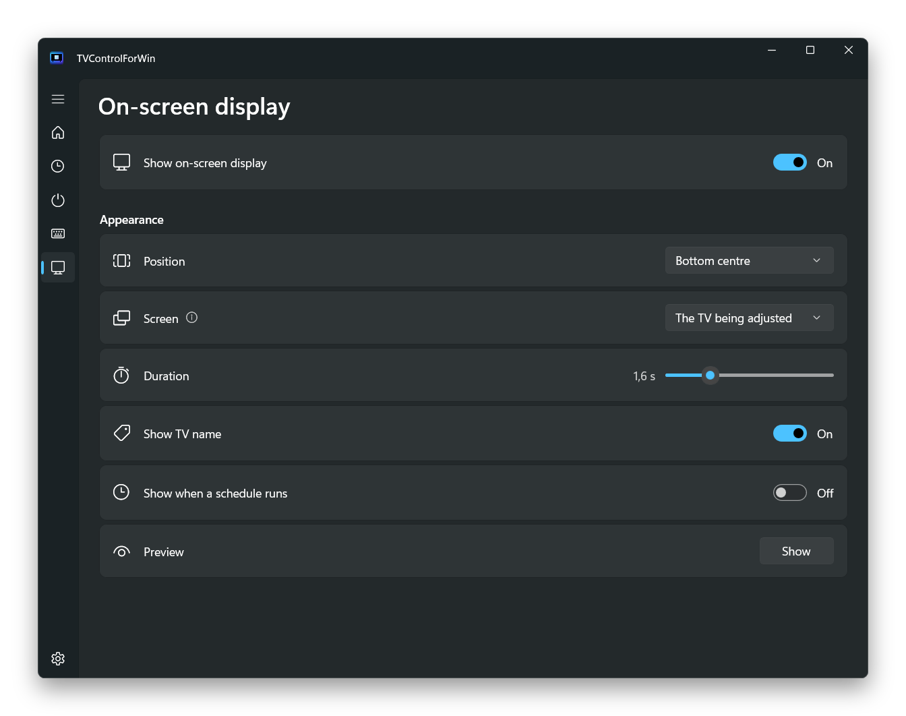
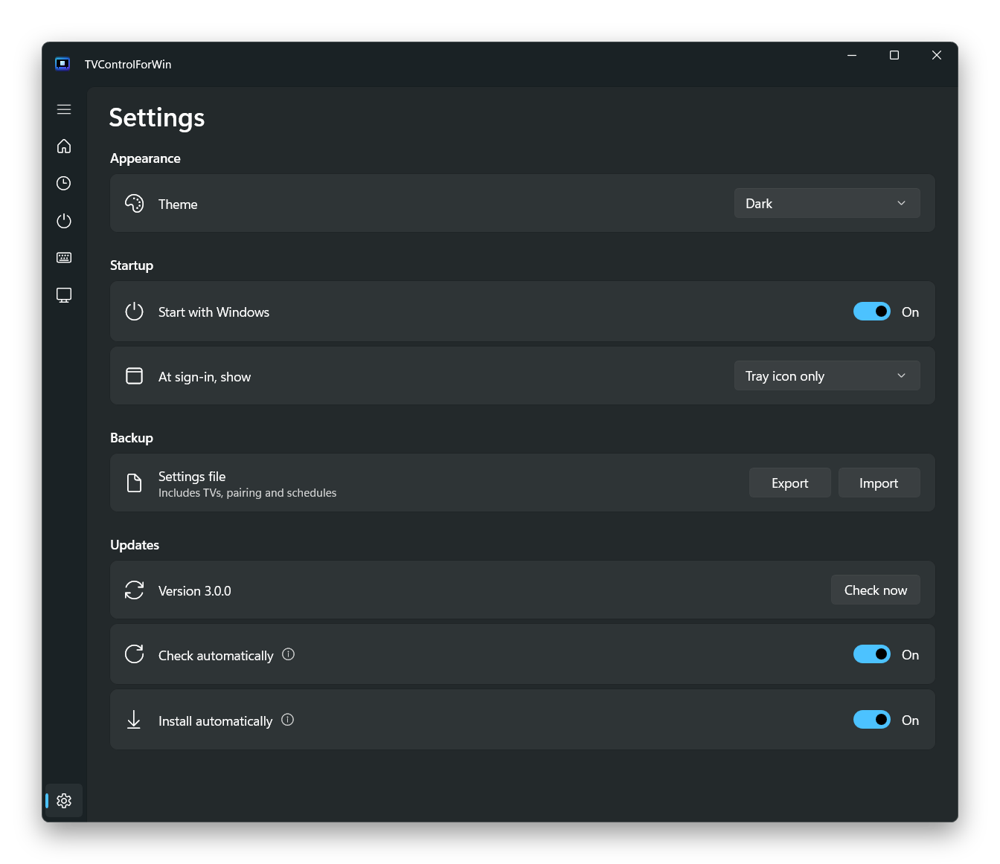

  

<h1 align="center">TVControlForWin</h1>

  
  
  
  
  

  <b>Change your TV's brightness and switch it on and off from your Windows PC.</b> 
  A small native app for TVs used as monitors. Works with LG and Google TV, over your home network.

  

  

   
  Press <code>Ctrl + Alt + ↑ / ↓</code> and a brightness bar slides in, just like the Windows volume one.

  <a href="#what-it-does">What it does</a> ·
  <a href="#which-tvs-work">Which TVs work</a> ·
  <a href="#install">Install</a> ·
  <a href="#set-up-your-tv">Set up your TV</a> ·
  <a href="#using-it">Using it</a> ·
  <a href="#if-something-isnt-working">Help</a> ·
  <a href="#contributing">Contributing</a>

## Why

If you use a TV as a monitor, you know the two annoyances: the Windows brightness slider
does nothing, and the TV stays on when the PC goes to sleep. TVControlForWin talks to the
TV over your home network and takes care of both.

## What it does

<table>
  <tr>
    <td width="50%" valign="top"><b>Brightness slider</b> One for each TV, right on your desktop.</td>
    <td width="50%" valign="top"><b>Keyboard shortcut</b> <code>Ctrl + Alt + ↑ / ↓</code> changes the TV your mouse is on, with a small on-screen bar like the Windows volume one.</td>
  </tr>
  <tr>
    <td valign="top"><b>Schedules</b> Bright in the morning, dim at night, or whatever suits you.</td>
    <td valign="top"><b>Power that follows the PC</b> The TV turns on when the PC starts or wakes, and off when it sleeps, shuts down or the screens time out.</td>
  </tr>
  <tr>
    <td valign="top"><b>Stays out of the way</b> Lives in the system tray and can start with Windows.</td>
    <td valign="top"><b>Keeps itself up to date</b> New versions arrive by themselves.</td>
  </tr>
</table>

## Which TVs work

| TV | Brightness | On / off |
|---|:-:|:-:|
| **LG** with webOS (C2, C3, G-series and similar) | ✅ | ✅ |
| **TCL** with Google TV | ✅ after a [one-time setup](#brightness-on-a-tcl) | ✅ |
| Other **Google TV / Android TV** (Sony, Philips, Hisense, Xiaomi, Chromecast…) | not yet | ✅ |

Samsung, Roku, Fire TV and Hisense VIDAA TVs are not supported.

Tested on an LG OLED42C3 and a TCL 65C765. No rooting or developer firmware needed.

## Install

1. Download **`TVControlForWin-…-setup.exe`** from the
   [latest release](https://github.com/itsAllexB/TVControlForWin/releases/latest) and run it.
   Prefer no installer? Take the **`.zip`**, unzip it anywhere and run `TVControlForWin.exe`.
2. Windows may show a blue "Windows protected your PC" box, because the app isn't
   code-signed yet. Choose **More info**, then **Run anyway**.
3. The installer asks whether to install for everyone or just for you. Both work. With
   "just for me", updates install by themselves; with "everyone", you confirm each one.

Coming from LGforWin? Install over it. Your TVs and settings carry over.

## Set up your TV

1. Make sure the TV is on, and on the same network as the PC.
2. Open TVControlForWin and select **Find TVs**. Pick your TV and select **Add**.
   You can also type the TV's IP address and select **Add TV**.
3. Pair it, once:
   - **LG**: accept the prompt that appears on the TV.
   - **Google TV**: the TV shows a code. Type it into the app and select **Confirm**.
4. More than one screen? On each TV's card, choose which Windows **Screen** it is. That's
   how the keyboard shortcut knows which TV your mouse is on.

### Brightness on a TCL

TCL keeps brightness behind Android's debugging switch, so it needs turning on once:

1. On the TV, open **Settings → System → About** and press OK on **Android TV OS build**
   seven times.
2. Open **Settings → System → Developer options** and turn on **USB debugging**. (No USB
   cable involved. On a TV this switch also covers the network.)
3. In the app, select **Set up** on the TV's card.
4. On the TV, tick **Always allow** and select **Allow**.

The TV then gets a slider and works with schedules and the shortcut like an LG does.

### Letting the PC turn the TV on

A TV can only be woken while it stays connected in standby. That's a setting on the TV:

- **LG**: turn on **Quick Start+** (also called *Turn on via Wi-Fi*, depending on the model).
- **Google TV**: **Settings → System → Power & Energy → Energy Modes → Increased**.
  Older models call it *Quick start* or *Wake on LAN*.

Turning the TV *off* from the PC works without any of this.

## Using it

### Keyboard shortcut

`Ctrl + Alt + ↑` and `Ctrl + Alt + ↓` change brightness by 10. On the **Hotkeys** page you
can change the keys, the step, and whether the shortcut controls the TV under the mouse,
all TVs, or always the same one. The bar that appears can be moved, shown on a different
screen, or switched off on the **On-screen display** page.

### Schedules and power

|  |  |
|:--|:--|
| **Schedule**: up to 10 times of day, each for all TVs or just some | **Power**: one set of rules for all TVs, or separate rules per TV |
|  |  |

A schedule that fires while a TV is off isn't lost: the TV gets that brightness the moment
it's back.

"Screen off" blanks an LG's panel and brings the picture back instantly. Keep in mind that
most TVs switch themselves off after a few minutes without a signal, so use "turn on when
the screens turn back on" together with it.

### Everything else

|  |  |
|:--|:--|
| **Hotkeys** | **On-screen display** |
|  |  |
| **Settings**: theme, start with Windows, backup, updates | |
|  | |

## Updates

About once a day the app checks this page's releases for a newer version.

| Your copy | What happens |
|---|---|
| Installed just for you | Downloads and installs by itself while the window is closed. |
| Installed for everyone | Downloads, then waits for you to select **Install** in Settings. A dot on the Settings tab tells you it's ready. |
| Portable (zip) | Tells you there's a new version and opens the download page. |

Both the daily check and the automatic install can be switched off under
**Settings → Updates**.

## Privacy

- The app talks to your TVs over your own network. Nothing about you or your TVs is sent
  anywhere.
- The only time it goes online is to check GitHub for a new version and download it.
- Your TVs and settings are saved on your PC, in `%LOCALAPPDATA%\TVControlForWin`.
- A settings backup (**Settings → Export**) contains the keys your TVs gave the app when
  you paired them. Keep that file to yourself.

## If something isn't working

**Find TVs doesn't find my TV.**
Check that the TV is on and on the same network (not a guest Wi-Fi). On older LG models,
turn on **LG Connect Apps** in the TV's network settings. You can always add the TV by its
IP address instead.

**The TV's card says "Can't reach the TV".**
The TV is off or has left the network. Hover over that line for what to check.

**The PC can't turn the TV on.**
See [Letting the PC turn the TV on](#letting-the-pc-turn-the-tv-on). A TV that has just
installed a system update may also need switching on by hand once.

**My Google TV says "Power only" and has no slider.**
Brightness works on TCL so far. Other brands keep that setting somewhere the app can't
reach yet. Switching on and off works on all of them.

**"No TV on this screen" pops up when I press the shortcut.**
The app doesn't know which TV that screen is. Choose a **Screen** on each TV's card.

**How do I remove it?**
**Windows Settings → Apps → Installed apps → TVControlForWin → Uninstall.** Your settings
stay in `%LOCALAPPDATA%\TVControlForWin`; delete that folder too if you want them gone.

Still stuck? [Open an issue](https://github.com/itsAllexB/TVControlForWin/issues) and say
which TV model you have.

## Contributing

Contributions are welcome, and support for more TVs most of all.

- **Have a TV that isn't supported, or a Google TV without the brightness slider?**
  [Open an issue](https://github.com/itsAllexB/TVControlForWin/issues) with the model.
  A plain "this works on my TV" report helps too.
- **Want to add your TV's brand?** [Adding a TV brand](docs/development.md#adding-a-tv-brand)
  shows where it plugs in, and how the TCL brightness call was found.
- **Found a bug or have an idea?** Issues and pull requests are both fine.

[CONTRIBUTING.md](CONTRIBUTING.md) has the details. To build, run
`pwsh -File build.ps1 -Configuration Debug -Run` (needs Visual Studio with the .NET desktop
workload). How the app talks to each kind of TV and how the project is laid out is in
[docs/development.md](docs/development.md), and plans live in [Todo.md](Todo.md).

## License

Copyright © 2026 Alex Bolocan.

TVControlForWin is free software: you can redistribute it and/or modify it under the terms
of the [GNU Affero General Public License](LICENSE) as published by the Free Software
Foundation, either version 3 of the License, or (at your option) any later version
(`AGPL-3.0-or-later`).

It is distributed in the hope that it will be useful, but WITHOUT ANY WARRANTY; without even
the implied warranty of MERCHANTABILITY or FITNESS FOR A PARTICULAR PURPOSE. See the
license for details.

Releases up to v2.1.1, published as LGforWin, were licensed under GPL-3.0 and remain
available under it. Third-party code and libraries are listed in
[THIRD-PARTY-NOTICES.md](THIRD-PARTY-NOTICES.md).
